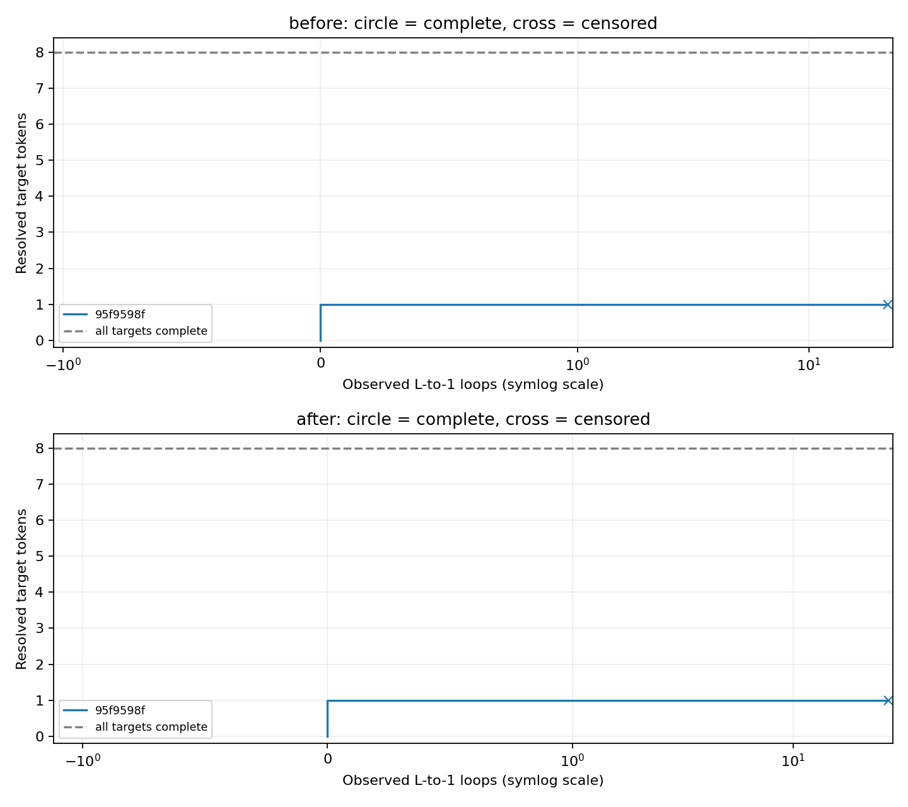

# 완주까지 필요한 루프 수 pilot

Token별 방문 한도 없음. 기존 상태와 cache를 유지하며 실제 다음 token을 맞히면 같은 layer에서 이어간다.

루프 1회 = 같은 target에서 실제로 마지막 layer → 첫 layer 전환이 관측된 것.

| 조건 | 완주/선택 시퀀스 | 완주 시퀀스 평균 루프 | 처리 target | 한 token의 최대 관측 루프 |
| --- | ---: | ---: | ---: | ---: |
| before | 0/1 | 미확인 | 1/8 | 22 |
| after | 0/1 | 미확인 | 1/8 | 27 |

| 조건 | Episode | 결과 | 맞힌/요청 token | 완주 루프 또는 관측 하한 | 중단 이유 |
| --- | --- | --- | ---: | ---: | --- |
| before | 95f9598f53 | 미완주·검열 | 1/8 | >= 22 | wall_time_watchdog |
| after | 95f9598f53 | 미완주·검열 | 1/8 | >= 27 | wall_time_watchdog |

미완주 행의 숫자는 관측한 루프 수의 하한이며, 그 횟수면 완주한다는 뜻이 아니다. 완주한 표본이 없으면 필요한 평균 루프 수는 미확인이다.

시간 제한은 episode 전체에 대한 외부 watchdog이다. 96회 token 예산이나 token별 강제 종료는 사용하지 않는다. 0초 설정은 시간 제한을 해제한다.

평가는 데이터 정답으로 분기를 고르는 oracle 방식이다. 학습 전/후는 같은 test episode를 사용한다. 기존 checkpoint는 96회 예산으로 학습됐으며, 이 pilot에서는 재학습 없이 더 오래 반복할 때의 동작을 측정한다.

동일한 수치 상태가 재관측됐는지도 저장한다. 이는 관측 지표이며 자동 종료나 완주 불가능 판정에 사용하지 않는다.

