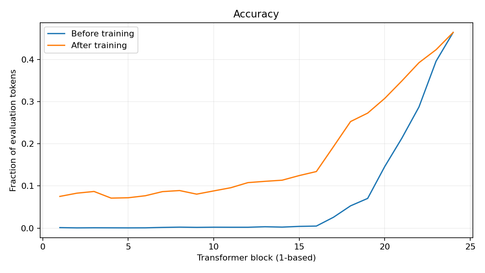
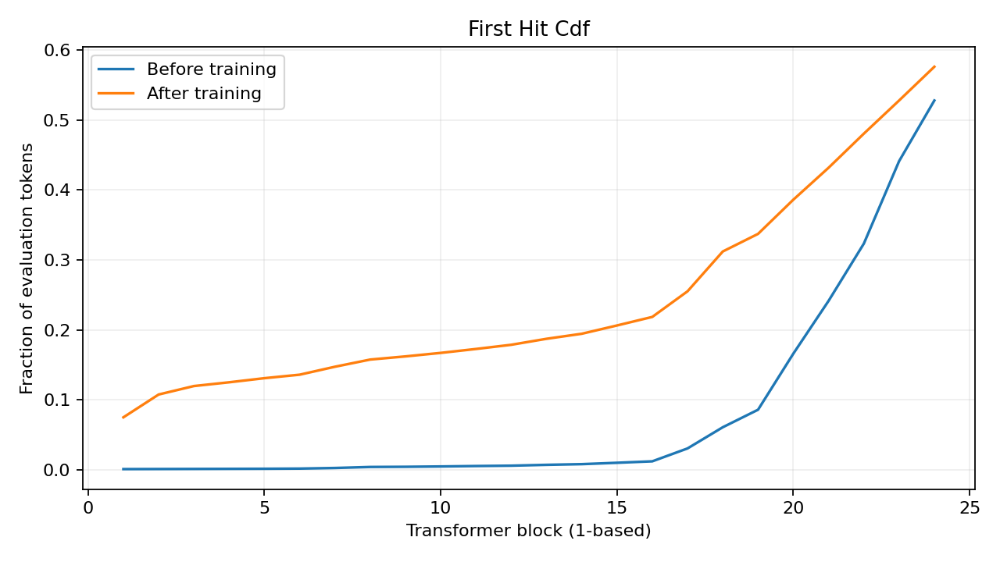

# 학습 전후 비교

Model: `Qwen/Qwen2.5-0.5B-Instruct`

평가 token: 8,192, 문서: 5. 동일 prefix·mask의 paired 비교.

| 지표 | 학습 전 | 학습 후 | 변화량 B−A | 변화량 95% CI |
| --- | ---: | ---: | ---: | --- |
| reference_hit_coverage | 0.527710 | 0.575928 | 0.048218 | [0.034813, 0.055156] |
| reference_no_hit_rate | 0.472290 | 0.424072 | -0.048218 | [-0.055156, -0.034813] |
| reference_first_hit_mean | 21.303262 | 14.942136 | -6.361125 | [-6.973867, -5.688264] |
| reference_stable_mean | 21.866579 | 18.781316 | -3.085263 | [-3.436449, -2.670140] |
| teacher_first_hit_mean | 21.954224 | 16.582275 | -5.371948 | [-5.868497, -4.803967] |
| oracle_fullscan_mean | 22.576904 | 18.783325 | -3.793579 | [-4.349791, -3.303660] |
| common_hit_first_depth | 21.306995 | 15.261160 | -6.045834 | [-6.700036, -5.360111] |

실패→성공: 529; 성공→실패: 134; 공통 성공: 4,189; 둘 다 실패: 3,340.

Adapter optimizer steps: 15; selected step: 15.

Validation NLL: 12.948057 → 7.699878.

Final-layer accuracy: 0.463867 → 0.463867 (고정 backbone/head).

최초·안정 깊이와 NLL은 낮을수록 좋고 coverage는 높을수록 좋다. 성공 subset 평균의 변화는 공통 성공 분석과 함께 해석한다.

Oracle block 수는 LM Head·gate·KV 보완 비용을 제외한다. 실제 속도 향상이나 순환 경로의 성공을 나타내지 않는다.

문서 단위 bootstrap CI다. 문서 수가 적은 smoke/pilot은 성능 결론에 사용하지 않는다.

